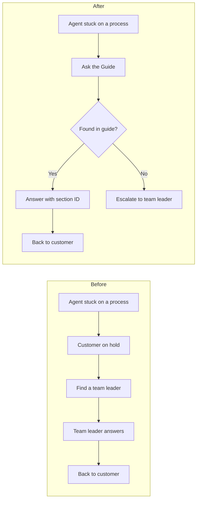

# Ask the Guide

When I worked in a sales and service call centre, we introduced an AI chatbot that agents could ask whenever they got stuck on a process. Before that, the answer was usually "put the customer on hold and find a team leader". Nobody ever measured whether it gave the right answers or how much time it actually saved.

So I rebuilt the idea from scratch and measured both. This is a small assistant that answers agent questions from an operations guide, says when it does not know, strips personal data first, and comes with an ROI model you can change.

## The process, before and after



## A quick note on the data

The company, Brightwater Home Services, is fictional. I wrote the 16-section guide (`data/ops_guide.md`) and 48 agent questions (`data/questions.csv`) myself, based on the kinds of things agents really ask. 40 questions have an answer in the guide and 8 deliberately do not, like "how many days of annual leave do I get". No real customer or company data is involved.

## How it works

1. **Personal data is removed first.** Emails, phone numbers, card numbers and postcodes are replaced with tags like `[EMAIL]` before a question is stored or sent anywhere.
2. **Retrieval.** The guide is split into chunks and searched with TF-IDF. I compared two chunking strategies, whole sections and 40-word windows.
3. **A confidence threshold**, tuned on half the questions only, decides whether to answer or send the agent to a team leader. The other half is a test set the method never saw.
4. **Context engineering.** The top two sections go into a prompt with strict rules: answer only from the extracts, cite the section ID, keep it short, and reply "NOT IN GUIDE" if the answer is not there. You can see the exact prompt in `output/sample_prompt.md`.
5. **Optional Claude step.** If you set an `ANTHROPIC_API_KEY`, the assistant uses Claude to write the answer. Without a key, it shows the matching guide section, which is how all the results below were produced.

## What I found

On the 24 test questions:

* For questions the guide does cover, it found the right section **19 times out of 20 (95%)**.
* Whole sections beat 40-word windows (95% against 85% on test). Small windows break each policy into pieces, so a question more often matched a fragment of the wrong section. The tuned threshold had to be stricter to compensate, and it sent 7 of the 24 test questions to a team leader. It is worth knowing, though, that the window version gave no wrong answers at all. That is the real trade-off: more answers, or fewer mistakes.
* **The failure that matters:** retrieval alone cannot tell an off-topic question from a real one. "How many days of annual leave do I get" matched the Annual service section because both contain "annual". A similarity score measures overlapping words, not whether the answer is actually there.

That is why the "NOT IN GUIDE" rule sits in the prompt as a second guardrail, and why I would add a thumbs-down button so agents can flag bad answers. I have not measured the Claude step yet, because these results were produced without an API key.

## Does it pay for itself?

The model in `roi_config.json` assumes a 40-agent team where each agent asks 4 questions a day, waits 3 minutes for an answer and takes 2 minutes of a team leader's time. It also charges 10 team leader minutes to fix every wrong answer.

With those assumptions it would save about **£40,000 a year after running costs** and pay back a £3,000 build in about **4 weeks**. Those are my estimates, not measurements, so I also ran a cautious version. Even at just 1 question per agent per day, it still saves about £9,300 a year and pays back in about 17 weeks.

With a real team, I would count questions to team leaders for two weeks before launch and two weeks after, rather than guess.

## What I would tell a team rolling this out

**Start with the guide, not the AI.** The assistant can only be as good as the document behind it. Out-of-date guides give confident wrong answers.

**Measure the "I don't know" path as carefully as the answers.** A wrong answer read to a customer costs more than a short wait for a team leader.

**Adoption is the real project.** Agents are more likely to trust an answer when they can see which part of the guide it came from, so the section ID is shown on every answer.

## Run it yourself

```
pip install -r requirements.txt
python assistant.py                         # evaluation, report and ROI
python assistant.py "customer wants 400 pounds back can I approve it"
```

Results go to `output/`: the report, per-question results, the ROI figures, a sample prompt and a manifest with data hashes, the train and test split, the threshold and the tool versions. Every run gives identical results.

Built with Python, scikit-learn and Pandas, using Claude Code.
